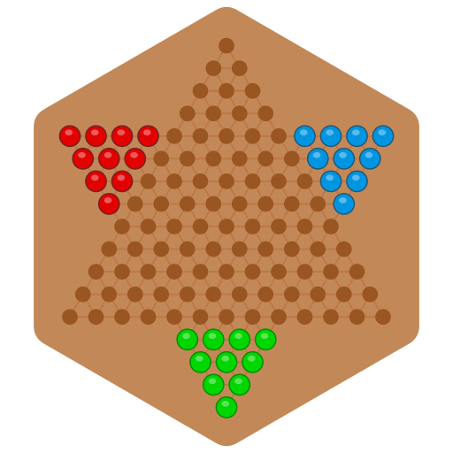

# cheech - Chinese Checkers

https://github.com/benjie-git/cheech

cheech is a networked, cross-platform Chinese Checkers game supporting a few
rule variations (please tell me if you know of other fun rule variations!),
chatting with other players, and AI computer players.

cheech runs on on *nix systems, Windows, and MacOS, and there is a
web-based client as well.

cheech is based on Loban Rahman's Gnome Chinese Checkers
(https://sourceforge.net/projects/gchch/).

## Using cheech

### Basic cheech

Run the program called cheech.  Choose the 'Host New Board' menu item and have
your friends connect to you.  Or use the 'Join a Board' menu item if someone
else is already hosting a cheech board.

If your friends are busy, Host a New Board, and add computer players into the
game using the 'Setup Computer Player...' and 'Add Computer Player' menu items.
Watch out, they're not super smart, but they are thorough!

To make a move, click on the peg you want to move, then on the empty hole to
move your peg to.  If you're making a multiple-hop move, you need to click on
each hole that you're hopping through along your chain of hops.  When you've
finished clicking out your hopping path, double click the last hole, or press
Enter to make your move.

### Advanced cheech

If you and your friends are all behind a port-blocking firewall, you can run
a separate cheech server on some publicly accessible server.  Run cheechd
on that server, and everyone can Join to that server's address.

You can also set up a cheechweb server so that people can join your game
just by browsing to a web site.  Cheech includes the web server it needs;
no separate web server or PHP is required.
- make sure the people trying to connect to cheechweb can access the cheechweb
  port of your computer (port 3839 by default)
- start cheechd with the -W flag, or host a game from cheech.
  (Make sure to enable cheechweb from the Host a new Board dialog in cheech.)
- point people to the url of the cheechserver.  This will be:
  `http://<computerHostingCheechweb>:<cheechwebPort>/`
  (by default this is http://localhost:3839/ , where other people should replace
  localhost with the IP address of your computer.)

## Building cheech

### Build on *nix/MacOS:

- install gtkmm4 (on a mac, run: brew install gtkmm4)
- run the below commands in the root directory of the cheech project.
  - autoreconf -i
  - ./configure
  - make
  - make install

Note: it's possible to build without the gui for a server-only setup.  In this case, just install:
 - brew install glibmm / apt install libglibmm-2.68-dev
 - Run ./configure with the --disable-gui flag, then make and make install.

### Building a MacOS app bundle

To build a self-contained Cheech.app instead of installing system-wide:
- install dylibbundler (on a mac, run: brew install dylibbundler)
- install gtk-mac-integration (on a mac, run: brew install gtk-mac-integration)
- run the below commands in the root directory of the cheech project.
  - autoreconf -i
  - ./configure
  - make
  - make bundle
- This results in a built Cheech.app, which can be dragged to
  /Applications if desired.  It pulls in all needed parts, and 
  can be safely be copied to other machines.

### Build on Windows (MSYS2 / UCRT64):

- Install MSYS2 (https://www.msys2.org/), and open the UCRT64 shell.
- In the UCRT64 shell, install the toolchain and libraries:
  - pacman -S base-devel mingw-w64-ucrt-x86_64-toolchain \
    mingw-w64-ucrt-x86_64-glibmm-2.68 mingw-w64-ucrt-x86_64-gtkmm-4.0
- run the below commands in the root directory of the cheech project.
  - autoreconf -i
  - ./configure
  - make
  - make bundle

- This results in a cleanly set-up Cheech folder containing cheech.exe.  You 
  can move this whole folder to where ever you'd like it - it pulls in all 
  needed parts, and can be safely zipped up and moved to other machines.

Ben Levitt 2005-2026  
with support from [Octopilot Electronics](https://octopilot.com)
